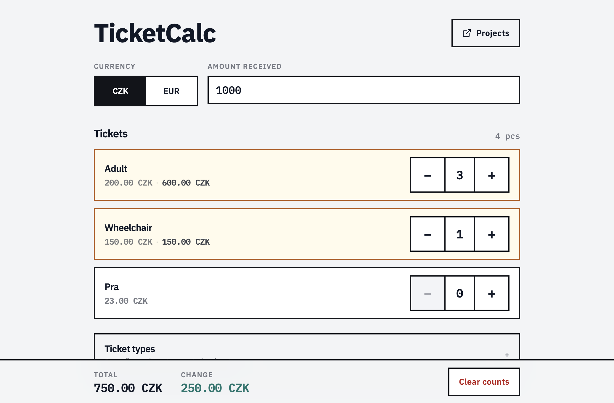
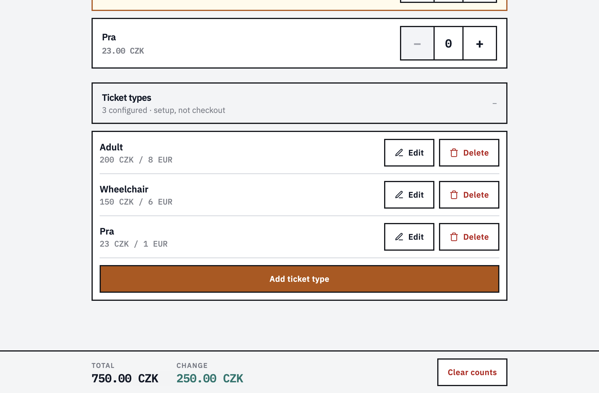

# TicketCalc

Box-office style ticket calculator for counting ticket types, totaling the sale, and working out change in CZK or EUR.

Set the currency and amount received, tap +/− on each ticket type, read total and change from the sticky bar. Ticket types (name + prices) are editable and kept in localStorage.





## What it does

- Dual currency pricing (CZK / EUR)
- Count tickets with large +/− controls and live line totals
- Sticky checkout bar: total, change (or still due), clear counts
- Add / edit / delete ticket types
- Persists currency, counts, amount received, and types in localStorage (memory fallback if unavailable)

## Stack

- React 18, Vite 5
- Tailwind CSS 3, DaisyUI 4
- IBM Plex Sans / Mono via Fontsource (self-hosted)
- Bun (`bun.lock`) for install and scripts

Client-only — no backend.

## Setup

Needs [Bun](https://bun.sh) ≥ 1.4.

```bash
git clone https://github.com/AkiraGold/TicketCalc.git
cd TicketCalc

bun install
bun dev            # http://localhost:5173
```

## Scripts

```bash
bun dev
bun run build
bun run preview
bun run lint
```

## Layout

```text
docs/               screenshots for this README
public/
src/
  components/       Header, counters, summary, type manager/modal
  hooks/            ticket calculator state
  utils/            localStorage helpers, money formatting
  App.jsx
  index.css         desk theme
amplify.yml         Amplify Hosting build (Bun → dist/)
index.html
package.json
bun.lock
```

## Deploy

Amplify Hosting uses `amplify.yml`: install Bun, `bun install --frozen-lockfile`, `bun run build`, publish `dist/`.

No Amplify Gen 2 backend — static frontend only.

## License

[MIT](LICENSE)
